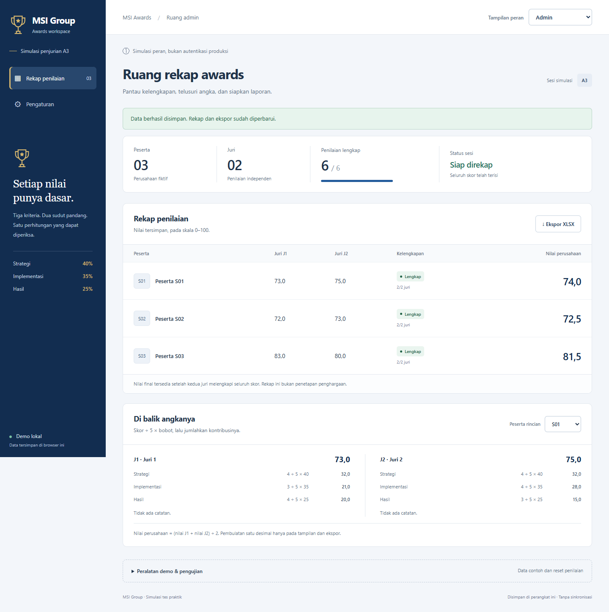
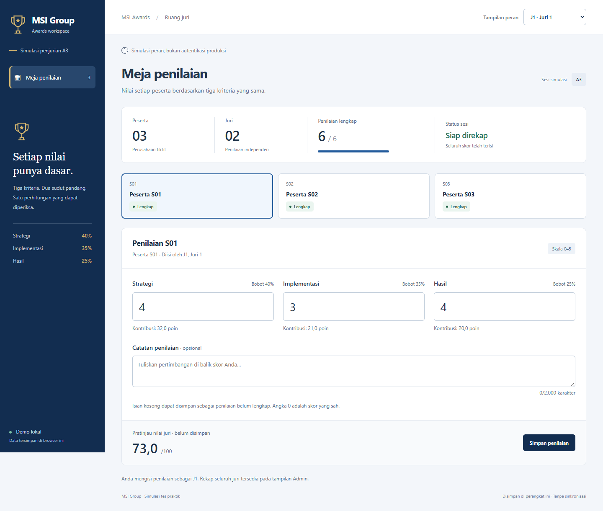
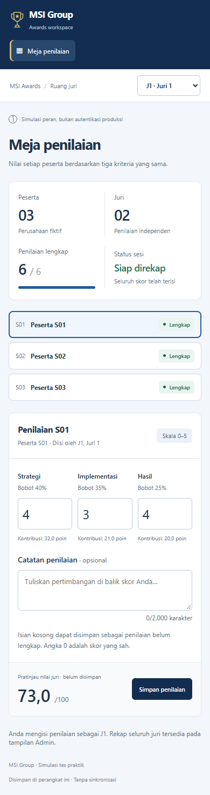
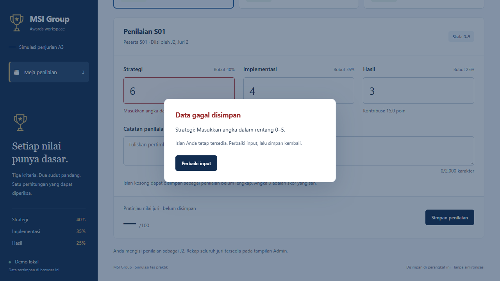

# A3-S01: bukti antarmuka

Screenshot diambil dari aplikasi yang berjalan menggunakan Microsoft Edge headless, dengan data contoh panduan. Gambar dapat dibuat ulang melalui `npm run test:e2e`.

## Admin

Desktop 1440 × 1080, tangkapan seluruh halaman. Rekap menampilkan 74,0; 72,5; 81,5, kelengkapan enam penilaian, dan rincian kontribusi S01.

## Juri

J1 hanya memiliki formulir penilaian miliknya. Pengaturan Admin dan tombol penggantian data tidak ditampilkan.

## Seluler

Viewport 390 × 844. Formulir dan pemilih peserta menyesuaikan lebar layar. Tabel admin dapat digulir mendatar di dalam panel; halaman tidak meluber secara horizontal.

Pemisahan tampilan ini tidak memberikan keamanan produksi. Label simulasi tetap ditampilkan pada semua peran.

## Modal validasi

Menyimpan skor 6 menampilkan alasan penolakan. Tombol Perbaiki input menutup modal tanpa menghapus isian. Tidak ada sakelar simulasi kegagalan.

